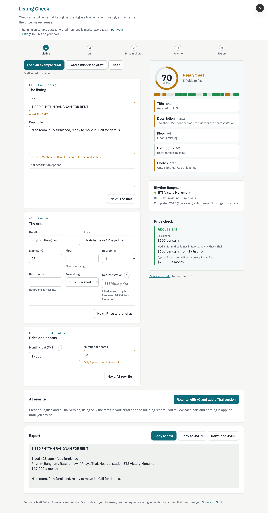
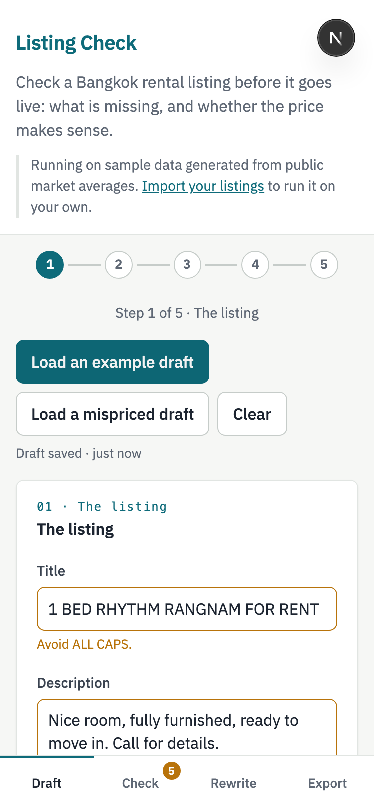

# Listing Check

Check a Bangkok rental listing before it goes live: what is missing, whether the price makes sense, and a cleaner English and Thai version written only from the facts in the draft.

**Live:** https://listing-check.vercel.app

## What it does

1. The agent types or pastes a draft: title, description, building, area, size, floor, beds, baths, rent, furnishing, photo count.
2. A completeness score out of 100, with the exact fields that are missing or weak and what to add.
3. A price check: rent per sqm against the median of comparable listings (same building and bedroom count, else same area, tier and bedroom count, and so on), with the sample size and the comparables named in words.
4. An AI rewrite in English and Thai. Every number and amenity word in the output is checked against the draft and the building record; anything not in the input is flagged for the agent to remove or confirm. Nothing is applied without a click.
5. A preview of the draft as a rental portal would show it, with every missing field named in its slot.
6. Export as text or JSON. A CSV importer loads your own listings so it runs on real data instead of the sample.

## The metric

Among the 71 of 400 sample listings that score under 85 on first pass, simulating an agent who accepts every suggested fix:

| | |
|---|---|
| Mean score before | 79.6 |
| Mean score after | 98.0 |
| Reach 85 or more | 71 of 71 |
| Rewrite calls | 71, $0.68 |
| Rewrites that added a fact not in the input | 0 of 55 fresh |

How it was measured, and what went wrong along the way, is in [BUILD_LOG.md](BUILD_LOG.md). The spec is [SPEC.md](SPEC.md).

## How to run it

Copy `.env.example` to `.env.local` with your Supabase URL and keys, then `npm install && npm run dev` and open http://localhost:3000.
`npm test` runs the 260 unit tests; `npm run check` verifies the benchmark against the database; `npm run metric` reproduces the table above. The walkthrough script is in [docs/walkthrough.md](docs/walkthrough.md).

## Stack

Next.js on Vercel. Supabase for Postgres, row-level security and the edge function that calls the model. Claude Sonnet 5.5 for the rewrite, chosen after a 20-listing comparison with Opus 5 (same cleanliness, a third faster, a third of the price). Sample data generated from public market averages; see `data/SOURCES.md`.
